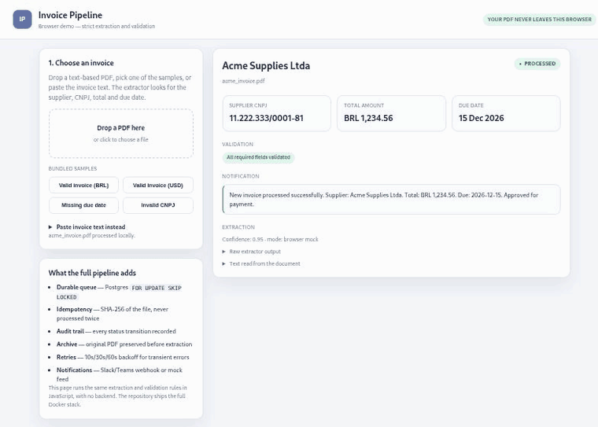
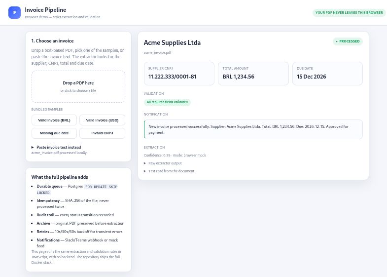

# Invoice Pipeline — browser demo

Static demo of the invoice extraction step. It runs **entirely in the browser**:
the PDF is read with [pdf.js](https://mozilla.github.io/pdf.js/), the fields are
extracted with label-based rules and validated deterministically. Nothing is
uploaded to a server.

**[Open the live demo →](https://jcmamoa.github.io/invoice-pipeline-demo/)**





## What it shows

| Field | Rule |
|---|---|
| Supplier | non-empty name from a `Supplier:` / `Fornecedor:` label |
| CNPJ | 14 digits and a valid check digit |
| Total | parses `1.234,56` and `1,234.56`; must be positive |
| Due date | parses common formats; must be between 2000 and today + 10 years |

Missing or invalid values are **never guessed**. The invoice is marked
`needs review` with the exact reasons, which is what the Python pipeline does.

## Try it

1. Open <https://jcmamoa.github.io/invoice-pipeline-demo/>.
2. Click one of the bundled samples, or drop your own text-based PDF.
3. The four samples produce:

| Sample | Result |
|---|---|
| `acme_invoice.pdf` | processed — BRL 1,234.56, due 2026-12-15 |
| `globex_invoice.pdf` | processed — USD 4,250.00, Portuguese labels |
| `missing_due_date.pdf` | needs review — `missing_due_date` |
| `invalid_cnpj.pdf` | needs review — `invalid_cnpj` |

Scanned PDFs have no text layer, so this page reports `no text layer`: OCR needs
a backend, and is not part of the static demo. In the full pipeline the same
file is OCRed locally and processed.

## Run locally

```bash
git clone https://github.com/JCmamoa/invoice-pipeline-demo.git
cd invoice-pipeline-demo
python3 -m http.server 8080
# open http://localhost:8080
```

Opening `index.html` directly with `file://` does not work because the sample
PDFs are fetched with `fetch()`; use a local server.

## Relationship to the full pipeline

This repository is the public, read-only demo. The full implementation is
private and adds:

- FastAPI intake API, folder watcher and optional IMAP ingestion
- Postgres queue with `FOR UPDATE SKIP LOCKED`
- SHA-256 idempotency
- archived original PDFs and audit trail
- local OCR (pypdfium2 + Tesseract) for scanned invoices
- Slack Block Kit / Teams MessageCard notifications with a mock feed fallback
- retries with backoff, stale-claim recovery and Prometheus metrics

The extraction and validation rules here are a faithful JavaScript port of the
Python modules, so both produce the same result for the samples.

## License

MIT.
